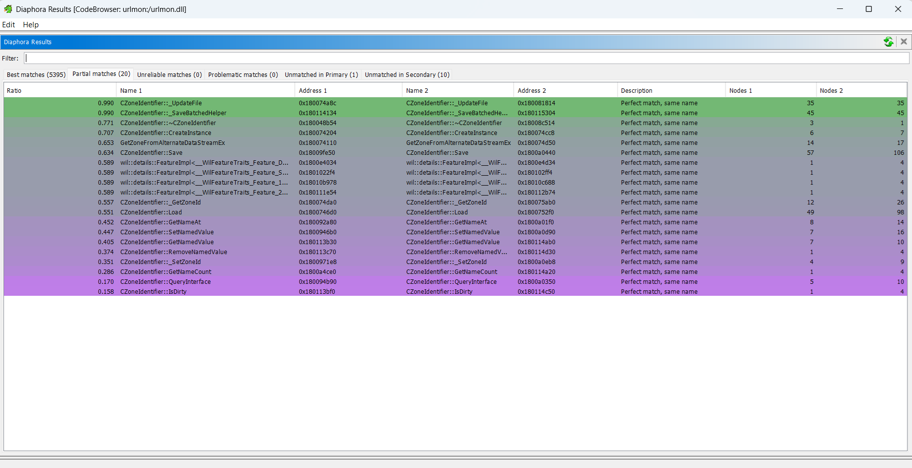
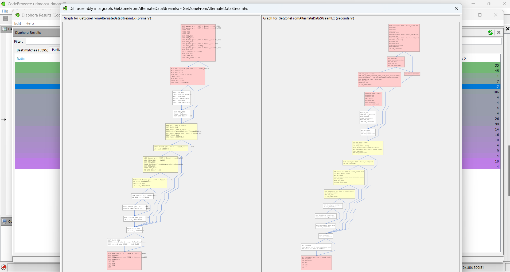
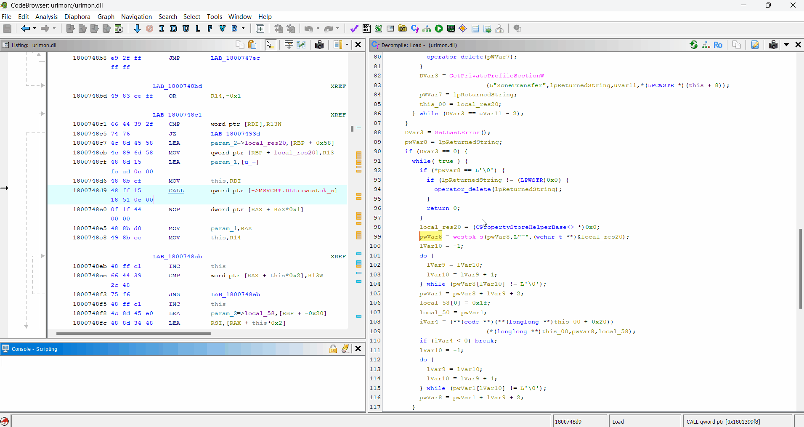
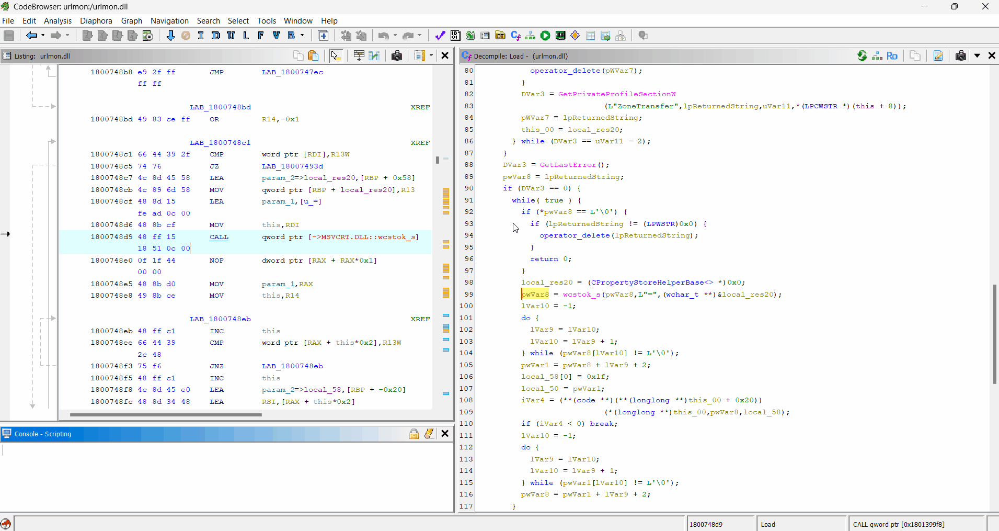

# Diaphora for Ghidra

Port of [joxeankoret/diaphora](https://github.com/joxeankoret/diaphora) (IDAPython) to Ghidra 12.1.4+, as a native Java extension. The SQLite database schema (version 3.4) and the SQL heuristics are those of the Python version. The port is based on Diaphora 3.4.1, commit [`de0eb92`](https://github.com/joxeankoret/diaphora/tree/de0eb920c1e54649bb3e7c4df5fa058b5c2cdc91) of the original repository.



> **Note:** So far the extension has only been tested on Windows.

> **IDA Pro users:** use the [original Diaphora](https://github.com/joxeankoret/diaphora) instead. It is actively maintained, and IDA Pro has IDAPython and the local Hex-Rays decompilers, so you get every feature: Python hooks, the machine learning model and the pseudo-code and microcode exports, heuristics and diffs.

Databases can be swapped with [diaphora-idafree](https://github.com/Claude-Rays/diaphora-idafree), the port for IDA Free/Pro, with limits. Tested in both directions:

- **diaphora-idafree databases in Ghidra:** the diff works, but gains little. IDA Free's cloud decompiler gives plugins no access to the decompiler API, so those databases have no pseudo-code, and only the assembly based heuristics and diffs can use them.
- **diaphora-ghidra databases in IDA:** the diff works if they were exported with level 1 off (*Name the locals v1, v2...* in the export dialog, see [Differences from the original](#differences-from-the-original)), without the benefits of level 1. diaphora-idafree crashes on databases exported with level 1 on.

So what swapping databases gains is a second set of results: in our test, diaphora-idafree found 35 partial matches and diaphora-ghidra 20. Databases exported by the original Diaphora (IDA Pro) have not been tested.

## Features

- **Export to SQLite (v3.4):**
  - Control flow graphs: basic blocks, edges, in and out degrees, cyclomatic complexity.
  - Strongly connected components and loops (Tarjan), topological sort and the **MD-Index**.
  - Pseudo-code from Ghidra's decompiler (`DecompInterface`): lines, AST primes (SPP) and KoretFuzzy hashes.
  - Assembly and pseudo-code normalized as Diaphora does (`clean_assembly`, `clean_pseudo`).
  - Constants, call graph and instruction level data as `diaphora_ida.py` stores it: addresses as RVAs, `assembly_addrs`, comments (`comment1`, `comment2`, `pseudocomment`) and the names and types of referenced items.
  - Structures, unions and enumerations as C definitions (`program_data`).
- **Diffing:** the **50 SQL heuristics** of Diaphora and its matching logic: "Perfect match, same name", `check_ratio` and `deep_ratio`, `cleanup_matches`, multimatch resolution and the callgraph based iterations. Matches land in the same choosers: *Best*, *Partial*, *Unreliable* (only with unreliable heuristics enabled), *Problematic*, *Unmatched in primary* and *Unmatched in secondary*.
- **Results window** docked in the CodeBrowser: text filter, rows colored by ratio as in Diaphora's choosers, double click to go to the function, and the right-click commands of the original (see [Usage](#usage)).
- **Import** (port of `diaphora_ida.py`): function names (mangled names are demangled and namespaces recreated), prototypes and comments; instruction level comments, names and types, aligning both functions' assembly as Diaphora does; structures, unions and enumerations. The imported functions are exported again into the primary database (`refresh_function_row`).
- **Results files:** `.diaphora` files in the SQLite format of the original.

## Build & install

Requirements: JDK 21+ and Ghidra 12.1.4+. The Gradle wrapper (`gradlew.bat`, Gradle 9.1.0) downloads Gradle, so there is nothing else to install.

```bat
set GHIDRA_INSTALL_DIR=C:\path\to\ghidra_12.1.4_PUBLIC
gradlew.bat buildExtension
```

The extension zip lands in `dist\` (`ghidra_12.1.4_PUBLIC_<date>_diaphora-ghidra.zip`). It includes [sqlite-jdbc](https://github.com/xerial/sqlite-jdbc), which Gradle downloads from Maven Central.

To install it:

1. In Ghidra's project window, open **File > Install Extensions...**, click **+** and select the zip.
2. Restart Ghidra.
3. Open a binary in the CodeBrowser. If Ghidra asks to configure the new plugins, enable **DiaphoraPlugin** (or enable it later in **File > Configure**).

## Usage

Everything is under the top-level **Diaphora** menu of the CodeBrowser:

| Entry | What it does |
|---|---|
| Diff or export | Export dialog. Exports the program to SQLite and, if a second database is selected, diffs them |
| Show results (F3) | Reopens the results window |
| Load results / Save results | `.diaphora` files. Load asks for the databases if they were moved |
| Load and import results | Loads a `.diaphora` file and imports every `sub_*` best and partial match with a ratio >= 0.5 (`DIAPHORA_MINIMUM_IMPORT_RATIO`) |
| Import definitions | Imports the structures, unions and enumerations of a database |
| Local diff | Diffs the function under the cursor against another function of the same program (`extras/diaphora_local.py`) |
| Pseudo-code diff settings | Not in Diaphora: level 2 of the pseudo-code diffs (see [Differences from the original](#differences-from-the-original)) |

Typical workflow: export binary A to `A.sqlite`, open binary B, and in *Diff or export* pick `B.sqlite` as output and `A.sqlite` as the database to diff against.

Right-click on the *Best*, *Partial*, *Unreliable* and *Problematic* tabs for the commands of the original:

| Command | What it does |
|---|---|
| Diff again | Opens the diff dialog again with the same databases |
| Save results | Same as the main menu |
| Add manual match | Pick a function of each database; the match goes to *Partial* with the ratio Diaphora calculates |
| Diff assembly / Diff pseudo-code | Side by side diff (the primary pseudo-code is decompiled again) |
| Diff assembly in a graph | Both basic block graphs side by side: modified blocks in yellow, new blocks in red. Drag to move, wheel to zoom, double click to fit |
| Diff using an external tool | Runs a command line with `$1` and `$2` replaced by the two files |
| Show assembly patch / Show pseudo-code patch | Unified diff |
| Show callers and callees graph | Call graph context of both functions |
| Import selected / Import selected sub_\* | Imports the selected matches (with one item, it also asks to import the definitions) |
| Import \*all\* functions / Import \*all\* data for sub_\* functions | Imports every match of the tab, or only those still named `sub_*` |
| Highlight / Unhighlight matches | Colors the matched functions in the listing |
| Delete match (or `Del`) | Removes the match |
| Go to primary address / Highlight basic block differences / Clear basic block colors | Extras of this port |

The *Unmatched* tabs only offer *Show assembly* and *Show pseudo-code*.

*Diff assembly in a graph* on `GetZoneFromAlternateDataStreamEx`: the primary and secondary graphs side by side, with the modified blocks in yellow and the new ones in red:



To regenerate the heuristics from a checkout of the original: `python tools/gen_heuristics.py C:\path\to\diaphora` (by default it looks for `..\diaphora`, next to this repository).

## Differences from the original

- **Canonical local names (optional).** Ghidra names locals after registers and stack offsets (`uVar3`, `local_28`), so two builds of the same function get different names and the pseudo-code diff of two builds is mostly noise. The port adds two optional phases, both on by default. With both off, the diffs are those of the original Diaphora on Ghidra's output; matching and the heuristics are unchanged.
  - **Level 1, canonical names** (`export/LocalNames`): the locals are named `v1`, `v2`... in the order of first use, as Hex-Rays does. It is applied when exporting, so it also changes the pseudo-code hashes. It is a checkbox of the export dialog, recorded in the database (`program_data`, `type = 'export_option'`, `name = 'canonical_local_names'`), and *Diff pseudo-code* decompiles the primary as the secondary was exported. Turn it off to export a database for diaphora-idafree, which does not accept databases exported with it.
  - **Level 2, renaming after the other side** (`util/LocalRenamer`): *Diff pseudo-code*, *Show pseudo-code patch* and *Local diff* rename the locals of the secondary side after the primary, matched by where they are used. Only the views change. It is set in *Diaphora > Pseudo-code diff settings*.

  Both are stored in the Ghidra preferences `diaphora.canonicalLocalNames` and `diaphora.renameLocals`.

  Level 2 on its own, with databases exported without level 1: *Diff pseudo-code* with level 2 off and then on. The change is small, because Ghidra usually gives the same names to the locals that did not change:

  

  Both levels, with databases exported with level 1: *Diff pseudo-code* with level 2 off and then on:

  
- **No microcode.** Ghidra has no Hex-Rays microcode, so the microcode columns stay empty and the microcode commands are disabled.
- **No Python.** Project-specific Python scripts (hooks) and the scikit-learn machine learning model are not supported.
- **Import:** type libraries (TILs), IDA function flags and forced operand names don't exist in Ghidra and are not imported.
- **No batch modes or standalone diffing.** The `DIAPHORA_AUTO*` batch modes and `python diaphora.py db1 db2` were not ported; diffing runs from the Ghidra UI. The configuration of `diaphora_config.py` is compiled in; `DIAPHORA_MINIMUM_IMPORT_RATIO` can still be overridden with an environment variable.
- **MD-Index** is computed in `double`. Python uses `Decimal` with 28 digits, so the text in `md_index` can differ in the last digits from a database exported by the Python version.

## License

Like the original, this port is released under the GNU AGPL v3; see [LICENSE](LICENSE). The parts ported from third-party code keep their notices in the source headers: kfuzzy (LGPL 2.1), Python's difflib (PSF License) and Paul Harrison's Tarjan sort. The extension zip bundles sqlite-jdbc (Apache License 2.0) and its dependency slf4j-api (MIT).
